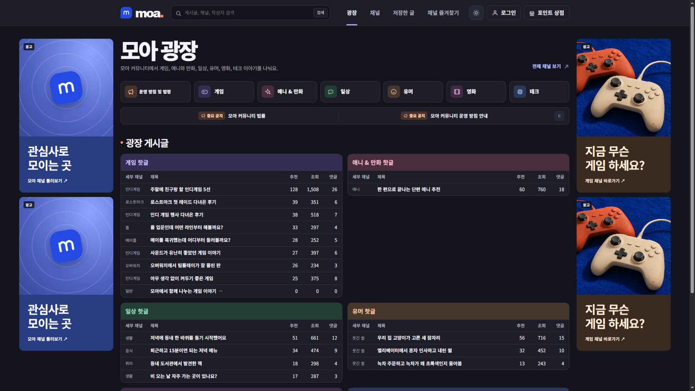
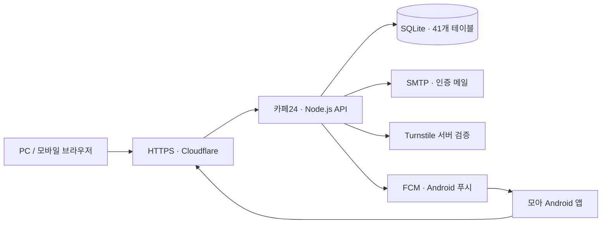

# 모아 커뮤니티 · 웹 서비스

**관심사를 채널로 나누고, 글과 댓글로 이야기를 이어 가는 한국어 커뮤니티.**

[서비스 방문](https://moapark.com) · [Android 앱 소개](https://github.com/taewan192/moa-android-intro) · [페이지 구성](docs/pages.md) · [DB 구조](docs/database.md)

모아는 아르카나 게이밍이 운영하는 커뮤니티입니다. 게임·애니와 만화·일상·유머·영화·테크를 상위 채널로 나누고, 그 아래 세부 채널에서 글·댓글·사진·영상·투표를 공유합니다. 웹과 Android 앱은 같은 회원 계정과 서버 데이터를 사용합니다.

이곳은 **서비스를 설명하는 공개 문서 저장소**입니다. 실행 가능한 전체 소스, 실제 회원 데이터, 운영 인증키와 서명키는 포함하지 않습니다. 문서는 **2026-11-27에 확인한 구현**을 기준으로 합니다.

> 화면 이미지는 실제 회원 정보가 없는 격리된 로컬 데모로 촬영했습니다. 채널·글·포인트·활동 수치는 설명용이며 운영 사이트의 실시간 수치가 아닙니다.

## 먼저 알아보기

| 궁금한 내용 | 안내 문서 |
| --- | --- |
| 어떤 기능이 있는가? | [회원·게시글·소통·운영 기능 전체](docs/features.md) |
| 어떤 페이지와 창으로 구성되는가? | [화면 지도, 주소, 화면별 요소와 접근 권한](docs/pages.md) |
| 웹·앱·서버가 어떻게 연결되는가? | [서비스 구조와 요청 흐름](docs/architecture-and-storage.md) |
| 어떤 데이터를 어디에 저장하는가? | [41개 테이블, 관계도, 파일·프로필·포인트 저장](docs/database.md) |
| 어떤 언어·도구로 개발하는가? | [개발 환경, 모듈 구성, 실행·배포와 확장](docs/development-and-operations.md) |
| 보안과 운영에서 무엇을 확인했는가? | [인증·권한·데이터 수명과 검증 범위](docs/security-and-validation.md) |

## 기능 한눈에 보기

| 영역 | 주요 기능 |
| --- | --- |
| 광장 | 채널별 인기글 최대 10개, 세부 채널·추천·조회·댓글 수, 중요 공지 자동 넘김 |
| 채널 | 상위/세부 채널, 제목·본문 검색, 최신·인기·조회 정렬, 즐겨찾기, 개설 신청·승인 |
| 글쓰기 | 숫자 글자 크기, 굵기·기울임·밑줄·색·링크, 글머리표, 최대 4단계 중첩 접기 |
| 본문 확장 | 이미지·GIF·영상, 이미지 확대, 첨부 수정, 표·그래프·투표, 표·투표 위치 지정 |
| 댓글 | 대댓글, 추천·비추천, 본인 수정과 수정됨 표시, 사진·닉네임·레벨·배지 |
| 계정 | 이메일 인증 가입, 아이디 찾기·비밀번호 재설정, 프로필 변경, 탈퇴 |
| 프로필 | 글·댓글·저장 수, 포인트·레벨·히스토리, 최근 1년 활동 달력과 날짜별 상세 |
| 소통 | 받은/보낸 쪽지·미확인 수·신고, 회원 차단과 쪽지 차단, 사이트 알림 |
| 운영 | 총괄·채널·세부 관리자, 신고·정지·뮤트·채널 제한, 블라인드·해제, 감사 기록 |
| 서비스 | 시스템 공지, 약관·정책, 광고·제휴 접수/관리, 방문 통계, Android 푸시 |

## 화면 구성

PC는 **상단 공통 메뉴 → 본문 → 하단 서비스 정보**를 중심으로 구성합니다. 넓은 화면에서는 본문 양쪽에 배너를 두 개씩 배치하고, 좁은 화면에서는 광고와 콘텐츠를 재배치합니다.

| 화면 | 사용 목적 |
| --- | --- |
| 광장 | 채널을 고르고 관심 있는 인기글을 빠르게 찾기 |
| 전체 채널 / 채널 / 세부 채널 | 주제 탐색, 게시글 검색과 정렬 |
| 게시글 상세 | 본문·첨부·표·투표 읽기, 댓글·추천·저장·신고 |
| 내 프로필 / 다른 회원 프로필 | 계정·활동·포인트 확인, 쪽지와 차단 |
| 관리자 패널 | 담당 범위에 맞는 신고·제재·블라인드·권한 관리 |
| 광고·제휴 / 개인정보처리방침 | 별도 주소로 제공하는 안내·접수 페이지 |

로그인·회원가입·복구·글쓰기·쪽지함 등은 현재 화면 위에 뜨는 대화상자를 사용합니다. 전체 페이지와 대화상자의 차이는 [화면 지도](docs/pages.md)에 정리했습니다.

## 개발 언어와 환경

| 계층 | 현재 구현 |
| --- | --- |
| 프런트엔드 | HTML, CSS, JavaScript, Fetch API, 해시 기반 화면 전환 |
| 백엔드 | Node.js 24 계열, 기본 HTTP 서버, CommonJS 모듈 |
| 데이터베이스 | Node 내장 node:sqlite / DatabaseSync, SQLite WAL |
| 이메일 | Nodemailer 10.5.0, SMTP |
| 인증 | 서버 세션 쿠키, scrypt 비밀번호 해시, 이메일 인증번호 |
| 봇·요청 대응 | Cloudflare 프록시·Turnstile과 서버 요청 횟수 제한 |
| 모바일 연동 | Java Android WebView, 같은 HTTPS API, FCM HTTP v1 |
| 운영 | 카페24 서버, HTTPS 도메인, 서버 프로세스와 데이터 디렉터리 분리 |

프런트엔드는 React·Next.js가 아닌 기본 웹 기술로, 서버는 Express가 아닌 Node 기본 HTTP 모듈로 구현했습니다. 현재 서비스 DB는 MySQL·PostgreSQL·Firestore가 아닌 **서버의 SQLite**입니다.

## 서비스와 DB 구조

회원·글·댓글·쪽지·사진·포인트는 서버가 기준입니다. 앱과 웹이 별도의 DB를 나중에 합치는 방식이 아니라, **같은 데이터를 필요할 때 API로 조회**합니다. 브라우저와 앱의 로그인 쿠키·화면 설정은 각각의 저장소에 남습니다.

닉네임·사진·배지는 회원 ID로 연결합니다. 닉네임을 변경할 때 과거 게시글 수백 개와 댓글 수만 개를 다시 쓰지 않고, 조회할 때 현재 회원 정보를 연결해 표시합니다. 사진·GIF·영상은 현재 SQLite BLOB에 저장하며, 푸시 등록과 발송 대기열도 같은 DB에서 관리합니다.

## 현재 상태와 문서 범위

- 웹 기능과 Android **모아 0.3.1**이 같은 서비스를 이용합니다.
- 앱의 Google Play용 서명 AAB 생성·검증을 완료했습니다. 스토어 승인·출시 상태는 별도입니다.
- 포인트 상점은 일반 회원에게 준비 중 안내를 제공합니다.
- 데모 화면 촬영, 소스·스키마 대조와 문서 링크 검사를 기준으로 정리했습니다. 성능 수치나 전체 실기기 호환성을 보장하는 자료는 아닙니다.

[Android 공개 설명](https://github.com/taewan192/moa-android-intro) · [개인정보처리방침](https://moapark.com/privacy) · [광고·제휴 문의](https://moapark.com/business)
