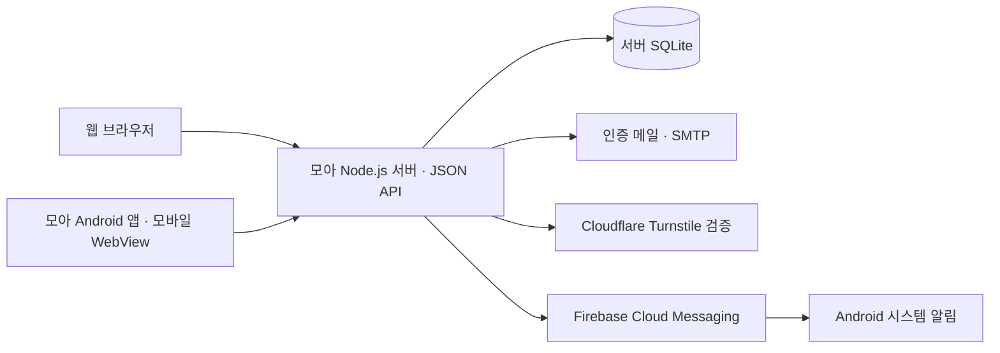

# 모아 커뮤니티 · 웹 서비스

[모아 방문하기](https://moapark.com) · [Android 앱 소개](https://github.com/taewan192/moa-android-intro)

모아는 아르카나 게이밍이 운영하는 한국어 커뮤니티입니다. 관심사별 채널과 세부 채널에서 게시글·댓글·투표를 나누고, 프로필·쪽지·포인트·알림을 함께 이용합니다.

이 저장소는 **기능과 구현 구조를 설명하는 공개 소개 저장소**입니다. 서비스 소스, 회원 데이터, 인증키와 앱 설치 파일은 별도의 비공개 저장소·운영 환경에서 관리합니다.

문서 갱신: **2026-11-25**. 연결된 Android 앱의 현재 개발 버전은 **모아 0.3.1**입니다.

## 주요 기능

| 영역 | 제공하는 기능 |
| --- | --- |
| 광장 | 게임·애니 & 만화·일상·유머·영화·테크별 인기글, 세부 채널 표시, 추천·조회·댓글 수 |
| 채널 | 상위/세부 채널 필터, 전체 채널 검색, 즐겨찾기, 세부 채널 개설 요청과 승인 |
| 게시글 | 제목·본문 검색, 이미지·GIF·영상, 이미지 확대, 첨부 수정, 글자 서식·링크·글머리표 |
| 편집 도구 | 중첩 접기, 표, 그래프, 투표, 표·투표의 본문 위치 지정, 무료 기본 이모지 |
| 댓글 | 대댓글, 작성자 프로필·레벨·뱃지, 본인 글/댓글 수정과 수정됨 표시, 추천·비추천 |
| 회원 | 이메일 인증 가입, 아이디 찾기·비밀번호 재설정, 닉네임·사진·뱃지 변경, 회원탈퇴 |
| 프로필 | 본인 글·댓글·저장 목록, 포인트 내역, 계정 히스토리, 날짜별 활동 달력 |
| 소통 | 받은/보낸 쪽지, 안 읽은 수, 신고, 회원 차단, 사이트 알림과 Android 푸시 연동 |
| 운영 | 총괄·채널·세부 관리자 권한, 신고 처리, 정지·뮤트, 포인트 조정, 블라인드, 운영 기록 |
| 안내 | 시스템 중요 공지, 법적고지, 신고기록, 광고·제휴 문의, 사이트 접속 통계 |

자세한 동작과 수치는 [기능 안내](docs/features.md), 데이터 흐름과 저장 구조는 [연동·저장 방식](docs/architecture-and-storage.md)에 정리했습니다.

## 서비스 구조

- 화면은 HTML·CSS·JavaScript로 구성하며, JSON API를 통해 서버에 조회와 변경을 요청합니다.
- 회원·글·댓글·쪽지·포인트의 기준 데이터는 서버에 있습니다. 웹과 앱이 같은 계정과 데이터를 사용합니다.
- Android 앱에는 모바일용 화면과 하단 메뉴, 설정, 파일 선택, 시스템 권한·푸시 수신 처리가 추가되어 있습니다.
- Cloudflare 프록시 환경에서 방문자 IP를 확인해 요청 횟수를 제한하며, 주요 인증 흐름은 Turnstile을 서버에서도 검증합니다.

## 기술 구성

| 구분 | 현재 구성 |
| --- | --- |
| 프런트엔드 | HTML, CSS, JavaScript, 브라우저 Fetch API |
| 서버 | Node.js 24 계열, 기본 HTTP 서버, CommonJS 모듈 |
| 데이터베이스 | 내장 `node:sqlite`의 SQLite, WAL, 외래 키, 트랜잭션 |
| 인증 | 서버 세션·쿠키, salt를 사용하는 scrypt 비밀번호 해시 |
| 이메일 | Nodemailer, SMTP 인증번호 발송 |
| 봇 대응 | Cloudflare Turnstile, 서버 요청 횟수·작성 간격 제한 |
| 앱 연동 | Android WebView와 동일 API, FCM HTTP v1 푸시 발송 |
| 배포 | 카페24 운영 서버의 서비스 프로세스와 HTTPS 도메인 |

## 공개 범위와 현재 상태

이 문서는 현재 코드에 있는 동작을 설명합니다. 스토어 심사나 광고 플랫폼 승인을 완료했다는 뜻은 아닙니다. 포인트 상점은 일반 회원에게 준비 중 안내를 제공하며, Android 설치 파일은 개발용 서명으로 시험 배포하는 단계입니다.

문의는 [모아의 광고·제휴 문의](https://moapark.com/business)에서 접수할 수 있습니다. 실제 계정 문의·신고에는 서비스 안의 해당 기능을 이용해 주세요.
