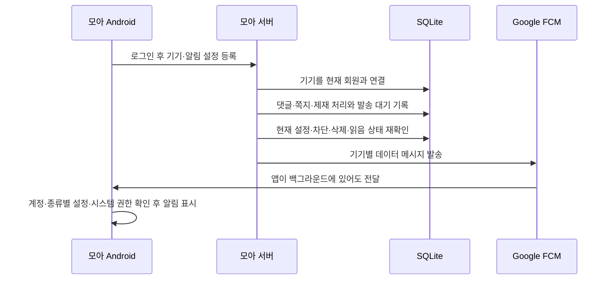

# 연동 방식과 데이터 저장 구조

[소개](../README.md) · [기능 안내](features.md)

## 1. 화면과 서버

웹 화면은 HTML·CSS·JavaScript로 구성합니다. 화면의 버튼이나 폼에서 JSON API를 호출하면 Node.js 서버가 입력·로그인·권한·이용 제한을 검사하고 SQLite를 읽거나 변경합니다. 서버가 처리한 결과로 목록·상세 화면·포인트·알림을 갱신합니다.

Android 앱은 같은 HTTPS 서비스와 API를 사용합니다. 모바일 전용 화면은 앱 실행 구분값과 User-Agent로 활성화하며, 앱용 CSS·JavaScript가 하단 메뉴와 설정, 모바일 채널·광고·하단 정보 배치를 구성합니다. Android 쪽에서는 파일 선택, 뒤로가기, 시스템 표시줄, 권한과 푸시를 담당합니다.

웹과 앱이 서로의 데이터베이스 파일을 복제하거나 일정 간격으로 합치는 구조가 아닙니다. **서버의 한 계정·한 데이터 집합을 각 화면에서 조회**합니다. 로그인 세션은 브라우저 또는 앱의 WebView 쿠키 저장소별로 관리하므로 웹에서 로그인했다고 앱도 자동 로그인되지는 않습니다.

## 2. 요청의 예

| 용도 | API 예시 | 검사와 처리 |
| --- | --- | --- |
| 로그인 상태 | `GET /api/session` | 세션 쿠키를 확인하고 현재 회원 표시 정보를 반환 |
| 가입·복구 인증 | `/api/register/email-code`, `/api/recovery/*` | 요청 횟수, 메일 주소, Turnstile, 인증번호 상태 검사 |
| 글 목록·상세 | `/api/posts` 및 하위 경로 | 채널·검색·정렬과 공개 범위, 블라인드·차단·제한 적용 |
| 글·댓글 작성 | 게시글·댓글 API의 변경 요청 | 로그인, 작성 간격, 담당 범위·뮤트·정지, 본문 검증 |
| 프로필 | `/api/profile/*`, `/api/profiles/*` | 본인용 목록·시각과 타인에게 공개할 항목을 구분 |
| 쪽지 | `/api/messages` 및 하위 경로 | 발신·수신 소유권, 차단 관계, 읽음·신고 처리 |
| 운영 | `/api/admin/*` | 서버에서 직급과 상위/세부 채널 범위 확인 |
| 앱 푸시 | `/api/push/config`, `/api/push/device` | 공개 앱 구성 조회와 기기별 로그인 계정·설정 등록 |

주소 목록은 구조 설명용이며 완전한 외부 개발자용 API 계약은 아닙니다. 버튼 숨김만으로 권한을 구현하지 않고 서버에서도 검사합니다.

## 3. SQLite가 저장하는 것

DB는 서버의 데이터 디렉터리 안에 있는 SQLite 파일로 관리합니다. 여러 변경이 함께 성공해야 하는 작업에는 트랜잭션을 사용하고 외래 키와 인덱스, WAL 모드를 적용합니다.

| 분류 | 주요 테이블 | 저장·연결 방식 |
| --- | --- | --- |
| 회원·로그인 | `users`, `sessions`, `signup_consents` | 계정, 현재 프로필, 비밀번호 해시·salt, 세션 토큰의 해시, 동의 버전·시각 |
| 이메일 인증 | `signup_email_codes` | 인증번호 검증용 MAC·해시와 만료·시도 상태. 비밀번호나 발송용 앱 비밀번호를 이 표에 평문 저장하지 않음 |
| 채널 | `channels`, `subchannels`, `subchannel_requests` | 상위/세부 관계, 순서, 개설 요청과 처리 상태 |
| 글·댓글 | `posts`, `comments`, `detached_deleted_comments`, `purged_posts` | 회원 ID로 작성자 연결, 대댓글 부모 관계, 본문·서식·수정·삭제 상태 |
| 첨부·사진 | `post_media`, `profile_avatars` | 파일 종류·이름·위치·버전과 바이너리 BLOB |
| 투표·반응 | `post_polls`, `poll_options`, `poll_votes`, `votes`, `comment_votes` | 질문·기간·항목과 회원별 투표·추천 관계 |
| 저장·즐겨찾기·차단 | `bookmarks`, `channel_favorites`, `member_blocks` | 회원 ID와 대상 ID의 관계 |
| 포인트 | `point_events`, `point_debits` | 획득·지급과 사용·차감 원장을 나눠 사유·날짜·처리자 기록 |
| 쪽지·사이트 알림 | `direct_messages`, `direct_message_reports`, `comment_notifications`, `post_blind_notifications` | 수신/발신자, 읽음 상태, 신고, 댓글·공개 상태 변경 안내 |
| 운영 | `moderators`, `subchannel_moderators`, `subchannel_restrictions`, `reports`, `audit_log` | 담당 범위, 제한 기간·사유, 신고 처리와 운영 감사 기록 |
| 활동·통계 | `account_history`, `profile_daily_activity`, `site_visitors`, `visits` | 변경 히스토리, 날짜별 관측 활동, 방문 식별자와 조회 중복 방지 |
| 문의·공지·설정 | `business_inquiries`, `channel_notice_templates`, `settings` | 광고 문의, 공지 템플릿, 기능별 초기화·마이그레이션 상태 |
| 앱 푸시 | `push_devices`, `push_queue` | 등록 기기·현재 회원·설정·FCM 토큰과 발송 대기 이벤트·재시도 상태 |

### 본문과 첨부

글 내용과 서식은 구조화된 데이터로 검증합니다. 글자 서식, 목록, 중첩 접기, 표·투표 삽입 위치, 그래프 수치를 구분하며 서버가 허용된 크기·단계·속성·링크를 검사합니다. 임의의 실행 코드를 본문 저장 형식으로 허용하는 방식이 아닙니다.

첨부 이미지·GIF·영상과 프로필 사진은 현재 SQLite BLOB으로 저장합니다. 브라우저·앱에는 권한을 검사하는 미디어 주소를 제공하고 파일 내용을 반환합니다. 운영 서버의 실제 첨부를 소스 저장소에 백업하지 않습니다.

### 프로필과 레벨

과거 게시글과 댓글은 회원 ID를 가지고 현재 닉네임·사진·뱃지를 조회합니다. 프로필 변경 때 모든 글과 댓글을 일괄 수정하지 않습니다. 탈퇴·시스템 작성자 등은 표시 규칙에 따른 이름을 사용합니다.

포인트 잔액은 적립·지급과 차감·사용 원장에서 계산합니다. 레벨은 누적 획득량과 레벨 초기화 기준을 바탕으로 계산하므로, 글마다 별도의 최신 레벨 값을 복사해서 동기화하지 않습니다.

## 4. 휴대폰·브라우저에 저장하는 것

| 위치 | 내용 | 역할 |
| --- | --- | --- |
| 브라우저/WebView 쿠키 | 서버 세션 쿠키, 방문 집계용 식별 정보 | 로그인과 방문 중복 집계 |
| 브라우저/WebView LocalStorage | 테마·읽기 크기 등 화면 설정 | 기기별 사용 환경 유지 |
| Android 앱 전용 SharedPreferences | 알림 전체·종류별 설정, 설치 식별 정보, 등록 변경 번호, 공개 Firebase 연결 정보 등 | 네이티브 알림 수신·표시와 기기 등록 동기화 |
| 서버 SQLite | 계정과 커뮤니티의 기준 데이터 | 여러 화면·기기에서 공통으로 사용하는 서비스 데이터 |

휴대폰에 전체 회원 DB나 모든 게시글을 다운로드해서 보관하지 않습니다. Android 앱의 로컬 설정은 서버 DB의 복사본이 아닙니다.

## 5. 이메일·보안 연동

인증 메일은 서버가 Nodemailer를 통해 SMTP로 발송합니다. 이메일 인증번호에는 5분 만료와 1분 재발송 제한을 적용하고, 가입·아이디 찾기·비밀번호 재설정의 흐름을 구분합니다. 코드 비교에는 서버 측 검증 데이터를 사용합니다.

비밀번호는 salt를 사용하는 scrypt 해시로 저장하고 로그인 세션은 토큰 자체 대신 해시를 DB에 보관합니다. 서버는 변경 요청의 Origin, 계정 소유권과 담당 채널 권한을 검사합니다. Turnstile은 화면 체크에 더해 서버에서 토큰·호스트·작업 종류를 확인합니다. 요청 횟수 제한은 프록시 환경의 실제 방문자 IP 식별과 연동합니다.

메일 발송 비밀번호, Turnstile Secret, FCM 서비스 계정 개인키는 서버 환경변수 또는 제한된 외부 파일로 주입합니다. 공개 문서·APK·소스 저장소에 실제 비밀값을 포함하지 않습니다. Firebase Android 연결 식별자는 서버 발송용 개인키와 용도가 다릅니다.

## 6. 앱 푸시 흐름

발송 이벤트는 DB 변경과 같은 트랜잭션에서 대기열에 들어갑니다. 발송 실패 시 간격을 늘려 재시도하고 유효하지 않은 등록 토큰은 제거합니다. 앱은 중복 메시지와 다른 로그인 계정의 메시지를 걸러 냅니다. 쪽지 본문·이메일·징계 자유 입력 사유를 푸시 본문에 그대로 담지 않습니다.

## 7. 보관·삭제와 표시 범위

| 대상 | 현재 동작 |
| --- | --- |
| 운영자 삭제 원문 | 공개에서 즉시 제외, 권한 있는 운영자만 7일 조회, 기한 후 원문 말소 |
| 작성자 직접 글 삭제 | 운영자 7일 보관 경로와 구분하여 즉시 삭제 |
| 탈퇴 계정 | 로그인 불가·익명화와 관련 개인 설정 정리. 남는 글·댓글은 탈퇴한 회원으로 표시 |
| 활동 달력 | 최근 365일 범위 관리. 본인의 관측 시각과 타인 공개 통계를 구분 |
| 광고·제휴 문의 | 현재 코드의 90일 보관 정리 작업과 총괄운영자 삭제 기능 적용 |
| 푸시 대기 기록 | 오래된 기록은 2일 기준 정리. 1시간이 지난 이벤트는 발송 대상에서 제외 |
| 사이트 접속 수 | 최근 5분 관측 브라우저 수·누적 식별 브라우저 수. 정확한 사람 수나 방문자 전체 IP·국가 로그를 뜻하지 않음 |

운영 감사 기록과 공개 원문, 회원에게 보여 주는 제재 내역은 서로 다른 자료입니다. 한 항목의 초기화가 모든 감사 데이터를 삭제한다는 뜻은 아닙니다. 실제 운영 데이터의 백업·접근권한·법적 보관 처리는 운영 환경과 고지에 맞춰 별도로 관리해야 합니다.
