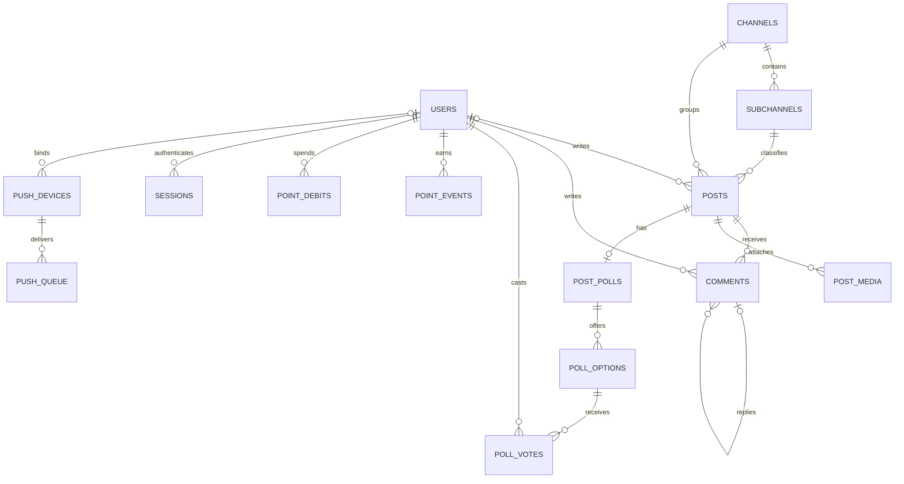
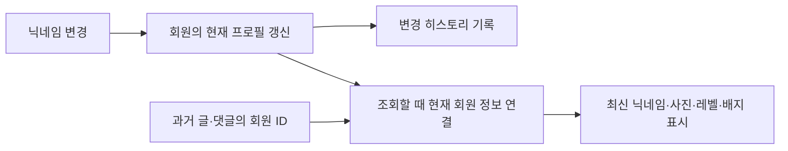

# 데이터베이스와 저장 설계

[소개](../README.md) · [서비스 흐름](architecture-and-storage.md) · [운영과 확장](development-and-operations.md)

## 1. 서버 SQLite가 기준 데이터

현재 구현은 Node.js 24의 내장 node:sqlite에 있는 DatabaseSync로 SQLite를 사용합니다. 새 격리 DB를 초기화해 확인한 사용자 테이블은 **41개**입니다. SQLite 내부 관리 테이블은 이 수에 넣지 않았습니다.

WAL, 외래 키 검사, secure_delete, 5초 busy_timeout, 준비된 SQL 문과 트랜잭션을 사용합니다. DatabaseSync는 동기식 API이므로 큰 쿼리나 큰 BLOB 처리가 서버 요청 지연에 영향을 줄 수 있습니다. WAL이 무제한 동시 쓰기를 가능하게 하지는 않습니다.

| 자료 | 저장 위치 |
| --- | --- |
| 회원·계정·권한 | 서버 SQLite |
| 게시글·댓글·투표·추천·저장·차단 | 서버 SQLite |
| 사진·GIF·영상·프로필 이미지 | 서버 SQLite의 BLOB |
| 포인트·신고·제재·운영 기록 | 서버 SQLite |
| 푸시 등록·발송 대기열 | 서버 SQLite |
| 로그인 쿠키 | 각 브라우저 또는 앱 WebView 저장소 |
| 테마·읽기 크기 | 브라우저/WebView LocalStorage |
| 앱 알림 스위치·설치 정보 | Android SharedPreferences |
| 발송용 비밀값 | 접근을 제한한 서버 설정/외부 파일 |

웹과 앱은 같은 API가 읽는 **같은 DB**를 사용합니다. Firebase는 Android 푸시 전달에 사용하며, 현재 회원·게시글을 Firestore나 Realtime Database에 저장하지 않습니다.

## 2. 핵심 관계도

아래는 전체 41개 중 주요 관계만 그린 개념도입니다. 컬럼 전체와 모든 연결을 표현한 물리 ERD는 아닙니다.

각 글·댓글은 회원 ID와 연결합니다. '표시할 이름'과 '누가 썼는지의 식별'을 구분하므로 닉네임이 바뀌어도 작성자 연결이 유지됩니다. 시스템 작성자·탈퇴 회원 표시는 별도 규칙을 적용합니다.

## 3. 전체 테이블 목록

연결 대상은 초기화한 DB의 외래 키 선언에서 읽었습니다. JSON 내부 참조, 소프트 삭제·익명화 규칙과 애플리케이션 검사는 이 열만으로 전부 표현되지 않습니다.

### 회원·인증

| 테이블 | 역할 | 연결 대상 |
| --- | --- | --- |
| users | 회원의 현재 계정·프로필·제한과 상태 | 직접 외래 키 없음 |
| sessions | 회원별 세션 토큰 해시와 만료 | users |
| signup_consents | 가입 때 동의한 문서 버전과 시각 | users |
| signup_email_codes | 가입·복구 이메일 코드 검증 상태 | 직접 외래 키 없음 |
| profile_avatars | 회원 프로필 이미지 BLOB과 메타데이터 | users |

### 채널·콘텐츠

| 테이블 | 역할 | 연결 대상 |
| --- | --- | --- |
| channels | 상위 채널 이름·설명·순서 | 직접 외래 키 없음 |
| subchannels | 상위 채널에 속한 세부 채널 | users, channels |
| posts | 글 본문·서식·작성자·공개/삭제 상태 | subchannels, channels, users |
| comments | 댓글·대댓글의 부모와 작성자·상태 | comments, users, posts |
| post_media | 게시글 첨부 BLOB과 순서·형식 | posts |
| post_polls | 글의 투표 질문·만료 | posts |
| poll_options | 투표 선택지와 순서 | post_polls |
| poll_votes | 회원의 투표 선택 | poll_options, users |
| votes | 게시글 추천·비추천 | posts, users |
| comment_votes | 댓글 추천·비추천 | comments, users |

### 개인 활동·관계

| 테이블 | 역할 | 연결 대상 |
| --- | --- | --- |
| bookmarks | 회원이 저장한 게시글 | posts, users |
| channel_favorites | 회원의 세부 채널 즐겨찾기 | subchannels, users |
| member_blocks | 차단한 회원과 대상 회원의 관계 | users |
| account_history | 생성·닉네임·레벨 변경 사건 | users |
| profile_daily_activity | 회원·날짜별 활동과 관측 시각 | users |
| site_visitors | 누적 방문 브라우저 식별·최근 활동 | 직접 외래 키 없음 |
| visits | 게시글 조회 집계의 중복 방지 | posts |

### 쪽지·알림

| 테이블 | 역할 | 연결 대상 |
| --- | --- | --- |
| direct_messages | 발신·수신 회원, 쪽지·읽음 상태 | users |
| direct_message_reports | 쪽지 신고와 처리 | users, direct_messages |
| comment_notifications | 댓글·대댓글 사이트 알림 | comments, users |
| post_blind_notifications | 게시글 블라인드·해제 알림 | posts, users |

### 운영·삭제 보관

| 테이블 | 역할 | 연결 대상 |
| --- | --- | --- |
| reports | 게시글·댓글 신고와 결과 | posts, users, channels, comments |
| audit_log | 운영 행위·대상·사유·시각 | users, channels |
| moderators | 상위 채널 운영자 연결 | users, channels |
| subchannel_moderators | 세부 채널 관리자 연결 | subchannels, users |
| subchannel_restrictions | 회원의 세부 채널 뮤트·이용 정지 | subchannels, users |
| subchannel_requests | 세부 채널 개설 신청·처리 | subchannels, users, channels |
| detached_deleted_comments | 부모 관계와 분리해 보관할 삭제 댓글 | users, channels |
| purged_posts | 원문 말소 후 필요한 처리 표식 | 직접 외래 키 없음 |

### 포인트·서비스·푸시

| 테이블 | 역할 | 연결 대상 |
| --- | --- | --- |
| point_events | 적립·지급 원장 | users |
| point_debits | 사용·차감 원장 | users |
| business_inquiries | 광고·제휴 문의와 관리 상태 | 직접 외래 키 없음 |
| channel_notice_templates | 채널 시스템 공지 템플릿 | 직접 외래 키 없음 |
| settings | 마이그레이션·초기화 등 서버 설정 | 직접 외래 키 없음 |
| push_devices | 기기·회원·FCM 토큰·설정 | users |
| push_queue | 푸시 발송 사건·시도·재시도 상태 | users, push_devices |

## 4. 주요 컬럼 지도

아래는 현재 스키마에서 확인한 컬럼 이름입니다. 행 데이터·실제 ID·이메일·토큰·비밀값은 포함하지 않습니다. 외부 클라이언트가 DB를 직접 수정하기 위한 공개 계약은 아닙니다.

| 테이블 | 컬럼 |
| --- | --- |
| users | id, username, nickname, salt, password_hash, created_at, role, email, suspended_at, suspension_reason, nickname_changed_at, suspended_until, level_points_offset, withdrawn_at, badge, email_verified_at |
| posts | id, channel, subchannel, author_id, author_label, title, body, summary, created_at, featured, base_votes, base_comments, views, important, deleted_at, court_role, incident_channel, incident_subchannel, incident_link, edited_at, channel_notice_copy, supervisor_only, body_format, blinded_at, blind_reason, auto_blind_override |
| comments | id, post_id, user_id, author_label, body, created_at, deleted_at, parent_id, hidden_at, edited_at |
| post_media | post_id, position, name, type, bytes |
| point_events | user_id, source_kind, source_id, amount, created_at, reason, actor_id |
| point_debits | id, user_id, actor_id, amount, reason, created_at, kind |
| push_devices | id, secret_hash, user_id, token, revision, enabled, allowed, comments, replies, sanctions, messages, updated_at |
| push_queue | id, device_id, user_id, event_key, category, source_kind, source_id, created_at, attempts, next_at, finished_at |

## 5. 닉네임·사진·배지 변경이 가벼운 이유

회원 한 명이 글 800개·댓글 17,000개를 작성했더라도 닉네임 변경 때문에 그 17,800개 행의 이름 문자열을 전부 다시 쓰지 않습니다. 현재 회원 정보를 변경하고 필요한 비용·히스토리만 처리합니다. 화면을 새로 조회하면 최신 정보를 표시합니다.

기존 글·댓글의 보조 작성자 문자열이 있더라도 정상 회원의 최신 표시 정보는 회원 ID 연결을 우선합니다. 운영 감사나 탈퇴·시스템 표시용 기록까지 모두 최신 이름으로 바꿔 과거 사실을 덮어쓰는 것은 아닙니다. 이 구조가 DB 전체의 부하가 언제나 0이라는 뜻도 아닙니다.

## 6. 본문·미디어·투표

게시글은 기본 텍스트와 허용된 구조화 서식을 검증해 저장합니다. 글자 서식·목록·접기를 구분하고 표/투표의 본문 위치 정보를 함께 처리합니다. 조회 시 허용된 요소로 다시 표시합니다.

첨부는 파일 메타데이터와 BLOB을 post_media에, 프로필 이미지는 profile_avatars에 둡니다. 소스 저장소의 정적 파일과 회원 업로드는 구분합니다. 현재 S3 같은 객체 저장소를 사용한다는 뜻은 아닙니다.

투표 질문은 post_polls, 선택지는 poll_options, 회원의 선택은 poll_votes로 나눕니다. 투표 종료 시각과 회원별 참여 여부를 서버에서 확인합니다. 추천·비추천도 회원과 대상의 관계로 기록합니다.

## 7. 포인트와 레벨

적립·지급은 point_events, 사용·차감은 point_debits 원장으로 나눠 관리합니다. 따라서 '보유 포인트'와 '레벨 계산에 쓰는 누적 획득량'은 같은 수치가 아닙니다. 사진·닉네임 변경 비용을 쓰더라도 일반 사용만으로 레벨이 내려가지는 않습니다.

운영자가 지급·차감·초기화할 때에는 권한을 확인하고 대상·사유·처리 시각을 기록합니다. 초기화 기준과 원장을 함께 고려해 잔액/레벨을 계산하며, 표시 숫자를 모든 과거 게시글에 복사해서 저장하지 않습니다.

## 8. 트랜잭션과 푸시 대기열

서로 묶인 데이터 변경은 하나의 트랜잭션으로 처리합니다. 예를 들어 글·댓글 작성과 관련 적립·알림, 운영 처리와 기록이 부분적으로만 남지 않도록 관련 작업을 묶습니다.

푸시 사건은 SQLite 트리거로 원래 변경과 같은 트랜잭션에 대기열을 만듭니다. 서버가 커밋 후 FCM으로 전송하며, 실패하면 대기열에서 재시도합니다. DB 변경과 네트워크 전송 자체를 하나의 원자적 작업으로 간주하지 않습니다.

## 9. 보관·삭제와 성능

삭제 원문·탈퇴 계정·운영 감사·포인트 원장·백업은 수명이 서로 다릅니다. 자세한 보관 기준은 [보안·데이터 수명](security-and-validation.md)에 정리했습니다. secure_delete 설정만으로 모든 WAL·백업·기기 저장소의 삭제까지 보장하는 것은 아닙니다.

SQLite 사용 적합성은 회원 수 하나보다 동시 쓰기와 미디어 크기·쿼리 지연·백업 시간을 보고 판단합니다. 현재 설계와 다음 확장 후보는 [운영 문서](development-and-operations.md)에 구분했습니다.
