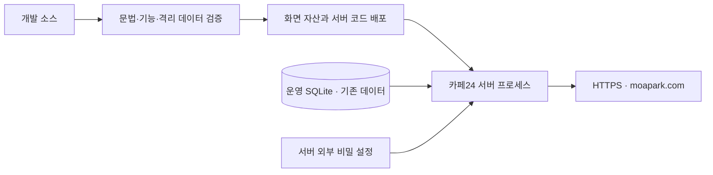

# 개발 언어·환경과 운영 구조

[소개](../README.md) · [서비스 흐름](architecture-and-storage.md) · [DB 상세](database.md) · [보안·검증](security-and-validation.md)

## 1. 기술 선택

| 구분 | 구현과 역할 |
| --- | --- |
| HTML | 화면 골격, 폼·대화상자, 의미 있는 목록·표 |
| CSS | PC·모바일 반응형, 라이트/다크, 광고·목록·에디터 레이아웃 |
| JavaScript | 화면 전환, API 호출, 에디터, 알림·계정·관리 동작 |
| Node.js 24 | HTTP 요청·정적 자산·인증·업무 API 처리 |
| CommonJS | 기능별 서버 모듈 분리 |
| SQLite / node:sqlite | 관계형 데이터, 트랜잭션, 인덱스, BLOB |
| Nodemailer 10.5.0 | SMTP로 인증 메일 발송 |

이 버전의 서버 package.json에 선언된 런타임 외부 의존성은 Nodemailer입니다. HTTP·암호화·파일·SQLite 등은 Node 기본 모듈을 사용합니다. React·Next.js·Express·ORM을 전제로 한 프로젝트 구조는 아닙니다.

## 2. 소스의 책임 분리

아래는 비공개 구현의 주요 파일과 역할을 설명하는 지도입니다. 이 공개 저장소에 해당 소스가 포함됐다는 뜻은 아닙니다.

| 서버 파일 | 담당 기능 |
| --- | --- |
| server.cjs | 서버 시작, HTTP 라우팅, 세션·계정, 글·댓글과 공통 응답 |
| governance.cjs | 운영자 범위, 신고·제재, 포인트·레벨, 운영 기록 |
| post-format.cjs | 글자 서식·목록·중첩 접기, 표·그래프와 삽입 위치의 구조 검증 |
| post-extras.cjs | 이미지·영상 BLOB과 투표 저장·조회·참여 처리 |
| member-tools.cjs | 저장·즐겨찾기·회원 관련 알림 보조 기능 |
| direct-messages.cjs | 쪽지 전송·조회·읽음·신고 |
| profile-calendar.cjs | 날짜별 활동과 본인/타인 공개 범위 |
| account-history.cjs | 계정 생성·닉네임 변경·레벨업 이력 |
| signup-email.cjs | 이메일 코드, 가입·아이디 찾기·비밀번호 복구 |
| signup-consent.cjs | 가입 동의 검증과 버전 기록 |
| turnstile.cjs | Turnstile 서버 검증 |
| push-notifications.cjs | 앱 기기 등록, DB 이벤트 대기열, FCM 발송 |
| business-inquiries.cjs | 광고·제휴 문의 접수·관리·정리 |
| channel-notices.cjs / community-rules.cjs | 시스템 공지 템플릿과 채널 공지 |
| seed.cjs | 새 로컬 DB의 데모 초기화 |

| 화면 파일 | 담당 기능 |
| --- | --- |
| public/index.html / styles.css / app.js | 웹 공통 화면·스타일·주요 라우팅 |
| public/post-editor.js | 글쓰기·서식·접기·표/투표 위치 등 편집 도구 |
| public/admin.js | 운영 패널 |
| public/member-tools.js / direct-messages.js | 회원 보조 UI와 쪽지 UI |
| public/mobile-app.css / mobile-app.js | Android 앱 모드 전용 화면·설정·브리지 |
| public/theme.js / emoji.js / turnstile.js | 테마·이모지·보안 인증 UI |
| public/business.html / business.js / business.css | 광고·제휴 안내와 문의 관리 |
| public/privacy.html / privacy.css | 독립 개인정보처리방침 |

## 3. 개발 환경과 실행 흐름

웹 소스는 Windows 로컬에서 개발하고 Node.js 24 환경에서 실행합니다. 운영 서비스는 카페24 서버에서 동일한 Node 애플리케이션을 HTTPS 도메인 뒤에 실행합니다. Android 빌드는 별도 SDK·JDK·Gradle 환경을 사용합니다.

다음은 **전체 소스에 접근 가능한 개발자용 예시**입니다. 이 공개 소개 저장소만 내려받아서는 서버를 실행할 수 없습니다.

```powershell
npm ci
$env:MOA_PORT = '4317'
$env:MOA_DATA_DIR = './data-local'
node server.cjs
```

서버 기본 포트는 4317입니다. 데이터 디렉터리를 분리해 테스트가 운영 회원 데이터에 영향을 주지 않게 합니다. 새 DB의 데모 계정과 실제 운영 계정은 구분해야 합니다.

| 설정 이름 | 용도 |
| --- | --- |
| MOA_PORT | 서버 리스닝 포트 |
| MOA_DATA_DIR | SQLite와 서비스 데이터 위치 |
| MOA_PUBLIC_ORIGIN | 운영 HTTPS Origin |
| MOA_GMAIL_APP_PASSWORD | SMTP 발송 인증값, 서버에서만 주입 |
| MOA_TURNSTILE_SITE_KEY | 공개 위젯 식별자 |
| MOA_TURNSTILE_SECRET_KEY | 서버 검증 비밀값 |
| MOA_FCM_CLIENT_CONFIG | Firebase Android 공개 구성 파일 경로 |
| MOA_FCM_CREDENTIALS | FCM 발송 인증 파일의 서버 전용 경로 |

실제 값이나 운영 파일 경로는 이 문서에 싣지 않습니다. 로컬 메일·Turnstile·FCM 시험에는 각 연동의 유효한 별도 구성이 필요합니다. 웹 서버가 켜졌다는 사실만으로 메일·푸시 발송까지 연결된 것은 아닙니다.

## 4. 배포할 때 바뀌는 것



코드 배포와 운영 DB 교체는 다른 작업입니다. 기능을 업데이트할 때마다 빈 DB로 덮어쓰는 방식이 아닙니다. 필요한 스키마 변경을 적용하면서 기존 회원·글·댓글을 유지합니다.

브라우저 정적 자산은 콘텐츠 해시가 붙은 주소와 긴 캐시 정책을 사용하고, HTML은 새 구성을 받을 수 있게 관리합니다. 서버 코드는 프로세스 재시작이 필요하며, 앱의 모바일 HTML/CSS/JS 수정은 서버 배포 후 새 화면 로드에 반영됩니다. 네이티브 Java·권한·패키지 변경은 새 앱 빌드가 필요합니다.

## 5. DB와 미디어 운영

WAL과 인덱스, 짧은 트랜잭션을 사용합니다. 첨부·프로필 사진이 BLOB이므로 DB 크기에는 텍스트뿐 아니라 미디어 크기도 포함됩니다. SQL 파일 하나만 복사하면 언제나 일관된 백업이 된다고 가정하면 안 됩니다. WAL 상태를 고려한 SQLite 백업/체크포인트 절차와 복원 검증이 필요합니다.

현재 구조의 판단 기준은 회원 수 하나가 아닙니다. 동시 쓰기, 큰 미디어 처리, DB 크기, API 지연, 디스크와 백업 시간이 더 직접적인 지표입니다. '회원 1만 명이면 반드시 문제없음' 같은 부하 검증 수치는 이 문서에 없습니다.

| 관측할 상황 | 다음 개선 후보 |
| --- | --- |
| 첨부 때문에 DB·백업이 커짐 | 미디어를 객체 저장소로 분리하고 DB에는 메타데이터 유지 |
| 동시 쓰기 대기·긴 트랜잭션 | 쿼리/인덱스 개선, 작업 분리, PostgreSQL 등 서버형 DB 검토 |
| 서버 인스턴스를 여러 개로 늘려야 함 | 공유 DB, 요청 제한·세션/대기열 저장 방식 재설계 |
| 인기 목록·프로필 조회 비용이 커짐 | 측정 기반 캐시·집계 도입과 변경 시 무효화 |

이 표는 확장 방향이며 현재 Redis·객체 저장소·PostgreSQL을 도입했다는 설명이 아닙니다.

## 6. 다른 PC에서 이어서 개발하기

전체 소스는 별도 비공개 저장소를 사용합니다. 새 PC에는 Node.js와 의존성을 설치하고 격리된 DB로 실행합니다. 운영 DB·SMTP/Turnstile/FCM 비밀값은 Git 소스와 별도로 필요한 환경에만 전달합니다.

앱 개발은 Android 프로젝트와 웹 프로젝트의 모바일 파일을 함께 이해해야 합니다. 앱 프로젝트만 수정해서 서버의 글쓰기 HTML이 바뀌지는 않습니다. 반대로 서버 CSS만 바꿔서 Android 알림 권한 코드가 바뀌지도 않습니다.

## 7. 참고 문서

- [Node.js 24 SQLite API](https://nodejs.org/docs/latest-v24.x/api/sqlite.html)
- [SQLite WAL](https://sqlite.org/wal.html)
- [SQLite Online Backup](https://sqlite.org/backup.html)
- [Android WebView](https://developer.android.com/develop/ui/views/layout/webapps/webview)

도구 버전은 프로젝트에 설정된 값입니다. 각 제품의 전 세계 최신 버전이나 공식 인증을 뜻하지 않습니다.
