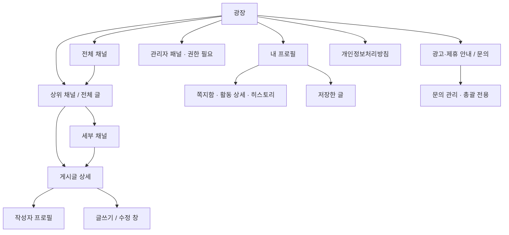
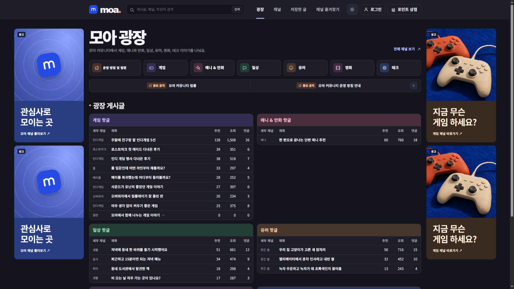
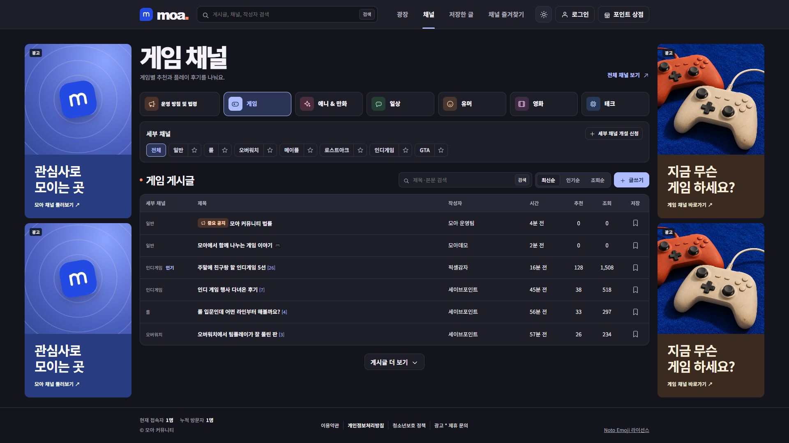
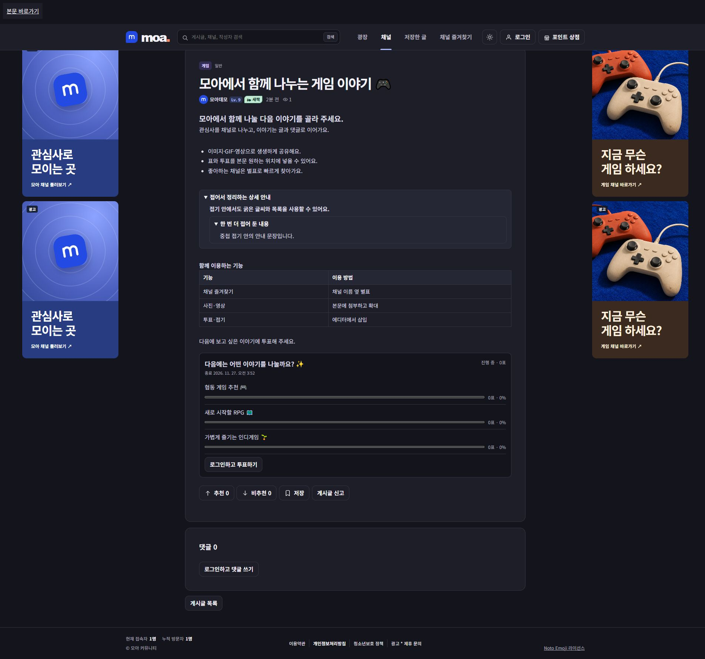
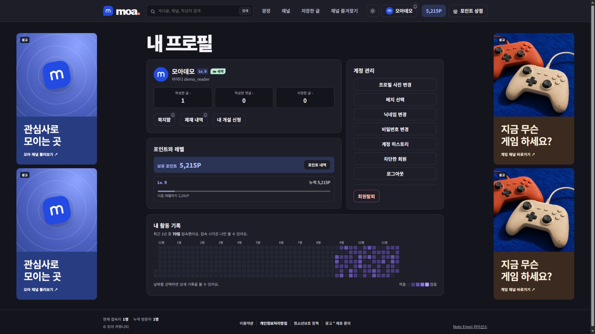

# 페이지와 화면 구성

[소개](../README.md) · [기능 안내](features.md) · [서비스 구조](architecture-and-storage.md)

## 1. 화면 지도

## 2. 주소와 접근 범위

대부분의 커뮤니티 화면은 하나의 HTML에서 주소의 # 이후 값을 바꿉니다. 광고·제휴와 개인정보처리방침은 독립적인 문서 주소도 제공합니다. 아래 ID는 형식을 설명하는 자리표시자입니다.

| 화면 | 주소 형식 | 접근 |
| --- | --- | --- |
| 광장 | /#home | 공개 |
| 전체 채널 | /#channels | 공개 |
| 상위 채널 전체 | /#channel/상위채널ID | 채널 제한에 따라 확인 |
| 세부 채널 | /#channel/상위채널ID/세부채널ID | 해당 세부 채널 제한 검사 |
| 게시글 | /#post/게시글ID | 비공개·블라인드·차단·이용 제한 적용 |
| 저장한 글 | /#saved | 로그인한 본인 |
| 내 프로필 | /#profile | 로그인한 본인 |
| 다른 회원 프로필 | /#profile/회원ID | 공개 허용 정보만 표시 |
| 관리자 패널 | /#admin 및 내부 탭 | 직급과 담당 채널 검사 |
| 광고·제휴 | /business | 안내·문의 접수 |
| 광고·제휴 문의 관리 | /business/inbox | 총괄운영자 |
| 개인정보처리방침 | /privacy | 공개, /privacy-policy 별칭 지원 |
| 앱 전용 설정 | /?app=android#settings | 앱 모드의 설정 화면 |

주소를 직접 입력해도 서버 권한 검사를 건너뛸 수 없습니다. 삭제 원문 조회 등 운영용 경로는 일반 목록과 분리합니다.

## 3. 공통 영역

| 위치 | 구성 |
| --- | --- |
| 상단 | 로고, 통합 검색, 광장·채널·저장한 글·즐겨찾기, 테마 전환 |
| 로그인 영역 | 프로필 사진·닉네임, 알림 종, 보유 포인트, 포인트 상점, 권한에 따른 관리자 진입 |
| 광고 | 넓은 PC 화면 양쪽에 상·하 두 개씩, 총 4개 |
| 하단 | 현재 접속·누적 방문 통계, 서비스 저작권, 이용약관·개인정보처리방침·청소년보호 정책·광고 문의, 이모지 라이선스 |

PC 배너 한 개의 안내 규격은 **260 × 425px**입니다. 실제 표시 크기와 배치는 화면 폭에 따라 달라집니다. 이 설명은 현재 배너 슬롯을 뜻하며 외부 광고 플랫폼 승인 상태를 뜻하지 않습니다.

## 4. 광장

처음 방문한 이용자가 주제를 고르고 인기글로 바로 이동하는 시작 화면입니다.

1. 서비스 제목과 소개, 전체 채널 보기 링크를 표시합니다.
2. 운영 방침 및 법령·게임·애니 & 만화·일상·유머·영화·테크를 선택합니다.
3. 중요 공지를 3개씩 묶어 넘깁니다. 일시정지/재생이 가능하며 비공개 공지는 권한에 맞게 제외합니다.
4. 콘텐츠 채널별 핫글을 세부 채널·제목·추천·조회·댓글 열로 보여 줍니다.

수동·자동 블라인드 글은 공개 핫글에서 제외합니다. 가오픈 안내는 별도 팝업이며 닫기와 오늘 그만 보기 선택을 제공합니다.

## 5. 채널과 세부 채널

상위 채널의 전체 글을 보다가 세부 채널을 선택해 범위를 좁힙니다. '전체'는 별도 복제 게시판이 아니라 해당 상위 채널의 글을 함께 보는 필터입니다.

| 영역 | 동작 |
| --- | --- |
| 채널 선택 | 현재 상위 채널을 강조하고 다른 채널로 이동 |
| 세부 채널 | 일반을 앞쪽에 표시하고 채널별 별표로 즐겨찾기 |
| 개설 신청 | 로그인 후 신청, 운영자 승인 절차 |
| 목록 도구 | 제목·본문 검색, 최신순·인기순·조회순, 글쓰기 |
| 게시글 행 | 세부 채널, 제목·댓글 수, 작성자 닉네임, 시간, 추천·조회, 저장 |
| 공지 | 일반 글과 구분되는 중요 공지 표시 |

목록 작성자 열은 닉네임 중심으로 간결하게 표시합니다. 상세 화면에서 사진·레벨·배지를 함께 보여 줍니다. 작은 화면에서는 각 행의 부가 정보를 재배치하며 표 전체를 PC 폭으로 억지로 줄이지 않습니다.

## 6. 게시글 상세와 작성 창

상세 페이지에는 위치 경로, 상위/세부 채널, 제목, 사진·닉네임·레벨·배지, 작성 시각·조회 수, 본문과 반응 버튼이 있습니다. 작성자 프로필로 이동할 수 있고 본인에게 수정·삭제를 제공합니다. 운영 권한에 맞춰 블라인드 등 도구가 추가됩니다.

본문은 글자 서식, 목록, 접기, 이미지·영상, 표·그래프·투표를 표시합니다. 이미지 클릭은 확대 보기를 열고 영상은 재생·전체 화면을 지원합니다. 본문 아래는 댓글·대댓글과 작성 영역입니다.

글쓰기/수정 창은 제목, 채널 선택, 본문 서식 도구, 첨부, 확장 기능 설정으로 구성합니다. 표·투표를 본문에 넣을 위치를 선택할 수 있고, 접기 안에 서식과 또 다른 접기를 넣을 수 있습니다. 저장 시 서버가 형식·크기·작성 제한을 검증합니다.

접기·표·투표가 함께 있는 데모 게시글 보기

## 7. 프로필

내 프로필은 개인 관리 화면입니다. 사진·닉네임·레벨·배지를 한 줄로 배치하고, 작성 글·댓글·저장 수에서 본인의 목록을 엽니다. 쪽지함·제재 내역에는 미확인 알림 표시를 제공합니다.

| 구역 | 내 프로필 | 다른 회원 프로필 |
| --- | --- | --- |
| 기본 표시 | 사진·닉네임·레벨·배지 | 동일 |
| 포인트 | 잔액, 내역, 레벨 진행 | 공개 잔액 |
| 글·댓글 수 | 본인 목록 열기 가능 | 수만 표시, 전체 작성 목록 연결 없음 |
| 활동 달력 | 활동 여부·글/댓글 수·최초/최종 관측 시각 | 활동 여부·글/댓글 수, 시각 비공개 |
| 계정 관리 | 사진·배지·닉네임·비밀번호, 히스토리, 차단 관리·탈퇴 | 제공하지 않음 |
| 소통 | 내 쪽지함 | 상대에게 쪽지 보내기·차단 |

활동 시각은 서버가 관측한 기록입니다. 휴대폰에서 실제 머문 모든 시간이나 정확한 체류 시간을 나타내지는 않습니다.

## 8. 관리자 패널

패널 진입과 각 API가 권한을 확인합니다. 총괄은 전체, 채널 운영자는 지정 상위 채널, 세부 관리자는 지정 세부 채널의 범위로 제한합니다.

신고 목록은 전체 → 상위 채널 → 세부 채널로 나누고, 정지 회원·뮤트/세부 채널 정지·블라인드 목록에서는 대상 검색과 상태 확인·해제를 제공합니다. 조항·사유·기간과 처리자를 기록하고 중요한 변경에는 확인창을 사용합니다.

회원 상세 관리에는 권한에 따라 포인트 지급·차감, 제재 내역 초기화, 포인트·레벨 초기화, 계정 정지·해제, 운영자 지정·권한 해제가 있습니다. 세부 관리자는 전역 계정 정지나 포인트·레벨 조정을 할 수 없습니다. 운영 기록과 회원에게 보여 주는 제재 내역은 따로 관리합니다.

## 9. 안내 페이지와 대화상자

광고·제휴 페이지는 배너 규격과 배치, 문의 카테고리, 담당자명·이메일, 선택 회사/기관, 문의 내용과 동의 항목을 제공합니다. 실제 문의는 서버 DB에 저장하며 별도 문의 관리 페이지에서 총괄운영자가 조회·삭제합니다.

개인정보처리방침은 로그인 없이 읽는 독립 주소를 제공합니다. 서비스 내부의 정책 공지와 시스템 중요 공지는 일반 작성자 계정 삭제와 분리해 유지합니다.

| 대화상자 | 주요 내용 |
| --- | --- |
| 로그인/가입/복구 | 아이디·비밀번호, 이메일 코드, 발송·만료 안내, 필요한 동의 |
| 쪽지함/보내기 | 받은·보낸 구분, 미확인 수, 읽기·답장·신고 |
| 계정 변경 | 비용·조건 안내와 새 값 입력 |
| 기록 | 포인트 원장, 계정 히스토리, 날짜별 활동, 제재 내역 |
| 운영 확인 | 대상 닉네임·아이디, 변경 권한·포인트·기간·사유 확인 |

기본 닫기 버튼 외에 바깥 영역 클릭으로 닫는 동작을 제공합니다. 입력·작업 확인은 각 기능의 절차를 따릅니다.
